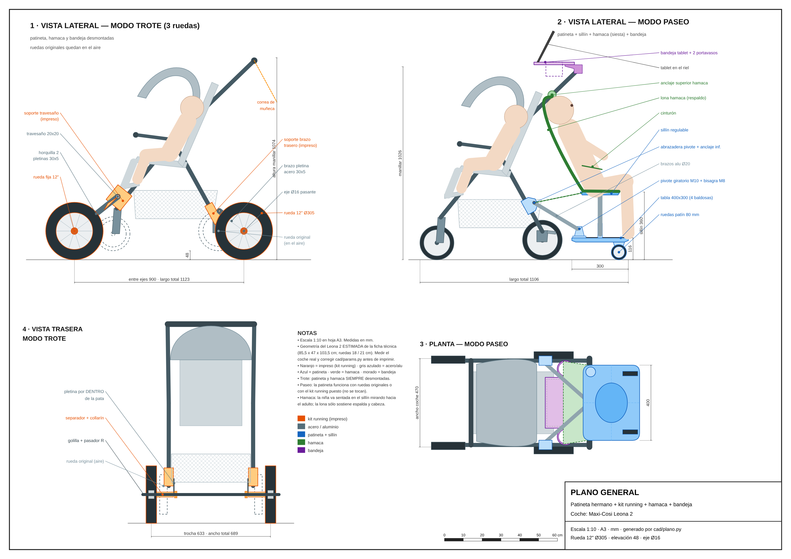

# Patineta hermano + kit running para Maxi-Cosi Leona 2

Accesorios imprimibles en 3D, desmontables y paramétricos, para el coche **Maxi-Cosi Leona 2**:

| Módulo | Qué hace | Carpeta STL |
|---|---|---|
| **1. Kit running** | Convierte el coche en un coche de trote de **3 ruedas de 12"**. Se monta con abrazaderas, sin perforar ni desarmar el coche. | `stl/01_kit_running` |
| **2. Patineta hermano** | Tabla con 2 ruedas que va **detrás** del coche y lleva un **sillín** desmontable para la niña de 4 años. | `stl/02_patineta` |
| **3. Hamaca (modo siesta)** | Lona colgada entre el manillar y las patas traseras para que la niña duerma. Su peso descansa en el sillín. | `stl/03_hamaca` |
| **4. Bandeja** | Bandeja sobre el manillar para una tablet de 11" o comida, con 2 portavasos, calzos y 2 vasos. | `stl/04_bandeja` |

**Plano general a escala 1:10 (A3):** [docs/plano_general.svg](docs/plano_general.svg)



> ⚠️ **Lee la sección [Seguridad](#seguridad) antes de usar nada con los niños.** Esto es una modificación casera.
> Maxi-Cosi no la aprueba, anula la garantía y el coche deja de cumplir su certificación. Pruébalo primero con un saco de arena de 20 kg.

---

## 1. Decisiones de diseño (y por qué)

### ¿Patineta adelante o atrás? → **Atrás, y fuera cuando se corre**
- **Adelante no funciona.** Ahí están el apoyapiés del bebé y la rueda delantera. Además, la niña taparía la vista del camino, y en un frenazo es la primera que choca.
- **Atrás** es donde van todas las patinetas comerciales. La niña va entre tus brazos, de frente al coche, y se afirma del manillar. Para que no choque con tus piernas:
  - los brazos van inclinados hacia el centro y el sillín queda en el **centro** de la tabla, así tus pies pasan por los costados;
  - la tabla **pivota** (pivote vertical M10 + bisagra M8), así sigue al coche en las curvas sin trabarse.
- **Cuando se trota, la patineta va plegada o se saca** (son 2 pernos M8). Con un adulto trotando detrás no queda espacio seguro para la niña. La idea es: **caminata = patineta, trote = solo el bebé**.

### Kit running: 4 → 3 ruedas, sin desarmar el coche
- Las ruedas originales **se quedan puestas**. Las ruedas nuevas de 12" (≈305 mm) son más grandes que las originales (21 y 18 cm), así que levantan el coche unos **5 cm** y las originales quedan en el aire. El cambio de modo se hace sin herramientas especiales.
- **Atrás:** cada pata trasera lleva un soporte impreso que se apoya sobre la carcasa de la rueda original, que hace de tope. A ese soporte se atornilla, por el **lado interior** de la pata, un **brazo de pletina de acero 30x5**.
  - Los dos brazos bajan hacia atrás y sostienen un **eje pasante de acero liso Ø16**.
  - El eje queda **135 mm detrás** y a la misma altura que el eje original. Así las ruedas nuevas no chocan con las originales y el coche sube 48 mm.
  - Las ruedas nuevas van por fuera de las originales, con un separador. Trocha ≈ 63 cm, ancho total ≈ 69 cm: pasa por puertas normales.
  - Las ruedas se sacan sin herramientas: golilla + pasador R.
- **Adelante:** un **travesaño de aluminio 20x20** va abrazado a las dos patas delanteras, **por encima** de las ruedas giratorias originales. De él sale una **horquilla de 2 pletinas de acero 30x5** con **una rueda fija** al centro y adelantada 23 cm, para que no toque el apoyapiés.
  - Una pletina de 30x5 trabaja a ~50 MPa con 45 kg de impacto. Una horquilla 100 % impresa no sería confiable para trotar.
- Una de las pletinas lleva el agujero del eje como **ranura**, para **alinear la rueda** (tracking) igual que un coche de trote comercial.

### Hamaca: cuelga del manillar, el peso lo recibe el sillín
Una niña de ~17 kg colgando del manillar, detrás del eje trasero, **puede volcar el coche hacia atrás**, sobre todo si el bebé no va sentado. Por eso:
- la hamaca se ancla arriba en los **tubos laterales del manillar** y abajo en las **abrazaderas de las patas traseras** (cerca del eje, donde no genera palanca);
- el fondo de la hamaca **se amarra al sillín** (4 ojales). El peso vertical baja por el sillín a las ruedas de la patineta, no al manillar;
- en la práctica es una **silla colgante con respaldo reclinado**: la niña va sentada en el sillín **mirando hacia ti** (hacia atrás), con espalda y cabeza apoyadas en la lona, que cuelga hacia el coche. Despierta, puede sentarse al revés, mirando al coche y agarrada del manillar.

### Bandeja
- Va **delante** del manillar, apoyada encima. Así tus manos quedan libres sobre el puño.
- Zona de tablet de 260 x 185 mm, con borde y **riel ranurado** para dejar la tablet de pie mirando hacia ti.
- 2 portavasos de Ø82 mm con ranura para el asa de un tazón, más **calzos** de TPU que lo reducen a Ø72 o Ø62 mm según el vaso.

---

## 2. Antes de imprimir: medir (5 minutos)

Las medidas del chasis del Leona 2 **no son públicas**. Los valores de `cad/params.py` son estimaciones; los que dicen `[MEDIR]` tienes que medirlos tú con un pie de metro:

1. Pata trasera: ancho (lado a lado), fondo (adelante-atrás) y radio de esquina, medidos justo **sobre** la rueda. También su inclinación, la altura de la parte superior de la carcasa de la rueda, y la distancia entre ejes original.
2. Pata delantera: lo mismo, más su inclinación respecto a la vertical (con una app de nivel en el celular).
3. Diámetro del manillar **con la espuma** y de los tubos laterales del manillar.
4. Luego corre `python3 cad/build.py` e imprime las **piezas de prueba** de `stl/00_pruebas` (5 minutos cada una). Deben entrar en el tubo con **~1 mm de juego por lado**. Ese juego lo rellena una tira de cámara de bicicleta, que da agarre y protege la pintura.

Ficha del coche usada como base: ancho 46,5–47 cm, rueda delantera 18 cm, trasera 21 cm, peso ~8,8 kg, asiento hasta 22 kg.

### Regenerar los STL
```bash
pip install manifold3d trimesh numpy networkx scipy
python3 cad/build.py            # todos los STL
python3 cad/plano.py            # plano general 1:10 con tus medidas + docs/lista_piezas_impresas.md + docs/cortes_metal.md
python3 cad/build.py bandeja    # solo las piezas cuyo nombre contenga "bandeja"
```
`CAMA` en `params.py` ajusta el tamaño de la impresora. Con 220 mm (Ender 3) entra todo.

---

## 3. Impresión

| Uso | Material | Paredes | Relleno |
|---|---|---|---|
| Abrazaderas, soportes, yugo, horquillas, pivote | **PETG o ASA** (nunca PLA: se deforma al sol o dentro del auto) | 6 | 100 % (o 60 % en tapas) |
| Baldosas de la tabla | PETG | 4 | 40 % giroide |
| Bandeja, portavasos, sillín | PETG | 3 | 25–30 % |
| Calzos de vasos, tapones | **TPU 95A** | 3 | 20 % |

- Todas las piezas ya vienen **orientadas** para imprimir sin soportes, salvo el terminal del brazo, que puede necesitar soporte bajo el tubo.
- Las tuercas van **cautivas** en alojamientos hexagonales. Pon la tuerca antes de apretar el perno.
- Detalle por pieza, con cantidades y medidas: [docs/lista_piezas_impresas.md](docs/lista_piezas_impresas.md)

---

## 4. Lista de compras

### Ruedas
No pude confirmar publicaciones puntuales vigentes, así que estas son las **especificaciones** a buscar y los términos de búsqueda.

| Para | Especificación | Dónde / cómo buscar |
|---|---|---|
| Kit running (x3) | **Rueda neumática 12" (12 1/2 x 2 1/4) con rodamientos**. Traseras con rodamiento para eje de 16 mm (5/8"); delantera con eje M10 o 3/8" y buje de ~80 mm de ancho | Mercado Libre: *"rueda coche de trote 12 pulgadas"*, *"rueda repuesto coche trote"*, *"rueda bicicleta aro 12 delantera"*. Falabella: *"rueda bicicleta aro 12"* |
| Alternativa más pesada | Rueda neumática de carretilla 10" (3.50-4 / 4.10-3.50-4), buje 5/8" | Sodimac: *"rueda neumática 10 pulgadas"*. Si usas esta, pon `RUEDA_RUNNING_DIAM = 260` |
| Patineta (x2) | **Rueda de patín en línea 80 mm 82A** + 4 rodamientos **608ZZ** | Falabella / Mercado Libre: *"ruedas patines 80mm 608"* |

> Mide el **diámetro interior del rodamiento** de la rueda que compres. Si no es 16 mm, cambia `RUEDA_RUNNING_BUJE`, regenera y usa un eje de esa medida (mínimo Ø15 de acero: el eje trabaja en voladizo).

### Metal y ferretería (Sodimac / Easy)
Largos exactos en [docs/cortes_metal.md](docs/cortes_metal.md) (se recalculan con tus medidas).

- **Eje de acero liso Ø16 (5/8") SAE 1020/1045** (eje trasero, ~760 mm). Perfora Ø4 cada punta para un pasador R. Agrega 4 golillas Ø16 y 2 pasadores R.
- **Pletina de acero 30x5** para los brazos traseros (2 x ~203 mm), con la plantilla [docs/plantilla_pletina_brazo_trasero_1a1.svg](docs/plantilla_pletina_brazo_trasero_1a1.svg)
- **Tubo cuadrado aluminio 20x20x1,5** (travesaño, ~530 mm)
- **Pletina de acero 30x5** para la horquilla (2 x ~304 mm). Perfórala con la plantilla 1:1 [docs/plantilla_pletina_horquilla_1a1.svg](docs/plantilla_pletina_horquilla_1a1.svg) y píntala o galvanízala en frío.
- **Tubo redondo aluminio Ø20** (2 brazos, ~350 mm) y **Ø25** (poste del sillín, 300 mm)
- Pernos (todos con tuerca **autoblocante** donde haya movimiento o vibración):
  - M6x50 x 24 (abrazaderas de pata), M6x100 x 2 (horquilla), M6x40 x 7, M6x35 x 8
  - M8x70 x 4 (brazos traseros a su soporte)
  - M8x50 x 3 + M8x60 x 2 (ruedas de patineta) + golillas de nylon
  - M10x60 x 1 (pivote) + M10 x 110 si la rueda delantera no trae eje
  - M5x35 x 8, M5x25 x 4, M5x20 x 16; M4x12 x 4, M4x20 x 3
- 1 cámara de bicicleta vieja (tiras de goma para las abrazaderas)
- Lija antideslizante autoadhesiva (*grip tape*) para la tabla
- **Correa de muñeca** con mosquetón para el manillar (obligatoria para trotar)

### Hamaca (costura)
- Lona Cordura 600D, 40 x 120 cm, y espuma de 10 mm para el respaldo
- Cinta de polipropileno de 25 mm, 6 m
- 4 hebillas escalera de 25 mm y 1 hebilla de seguridad (*side release*) de 25 mm para el cinturón

---

## 5. Armado
Guía paso a paso: **[docs/guia_montaje.md](docs/guia_montaje.md)**

---

## Seguridad
- **Prueba de carga:** antes de subir a los niños, carga 20 kg (saco de arena) en el asiento y otros 20 kg en la patineta o hamaca. Camina 2 km por pavimento irregular y revisa que nada se haya movido ni agrietado.
- **Trote:**
  - Usa siempre la **correa de muñeca**.
  - El kit no tiene **freno de mano** ni suspensión: corre a ritmo moderado, en superficies razonables y nunca en bajadas fuertes.
  - Los fabricantes de coches de trote recomiendan desde ~6–9 meses con buen control de cabeza, así que tu bebé de 1 año está bien. Reclina un poco el respaldo y ajusta siempre el arnés de 5 puntos.
  - Para girar, presiona el manillar y levanta un poco la rueda delantera, como en cualquier coche de rueda fija.
- **Patineta, sillín y hamaca: solo caminando**, nunca trotando.
  - La niña debe ir agarrada al manillar o con el cinturón de la hamaca abrochado.
  - Nunca sueltes el coche con la niña en la hamaca: podría volcar hacia atrás. Si notas que el coche "se va para atrás" con la niña sola, no la uses así.
- **Mientras duerme en la hamaca:** que el mentón no quede pegado al pecho. Revisa a la niña seguido.
- **Revisión antes de cada salida:**
  - piezas impresas sin grietas;
  - pernos apretados;
  - ruedas infladas a la presión del neumático;
  - la rueda delantera sigue derecha (si el coche "tira" hacia un lado, ajusta la ranura de la pletina).
- Si una abrazadera se desliza, no aprietes más el plástico: revisa la goma o vuelve a imprimir con la medida corregida.

## Estructura
```
cad/params.py   ← TODAS las medidas (edita aquí)
cad/geom.py     ← geometría del coche y posiciones derivadas
cad/plano.py    ← genera docs/plano_general.svg (plano 1:10)
cad/parts.py    ← geometría de cada pieza (Python + manifold3d, estilo OpenSCAD)
cad/build.py    ← genera stl/ y docs/
stl/            ← STL listos para laminar
docs/           ← guía de montaje, lista de piezas, cortes, plantilla 1:1, esquema
```
